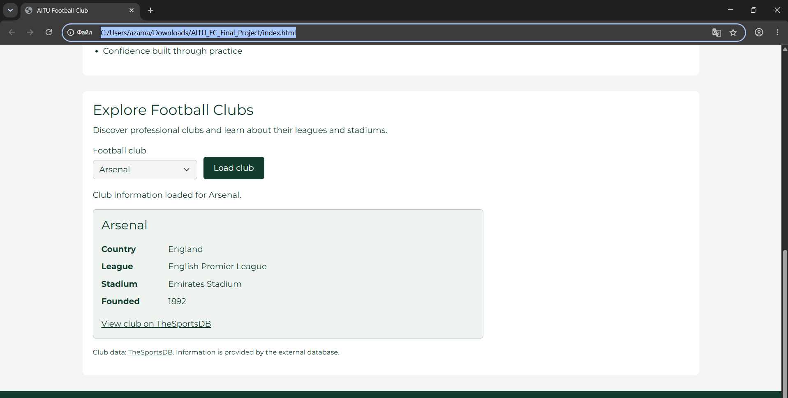
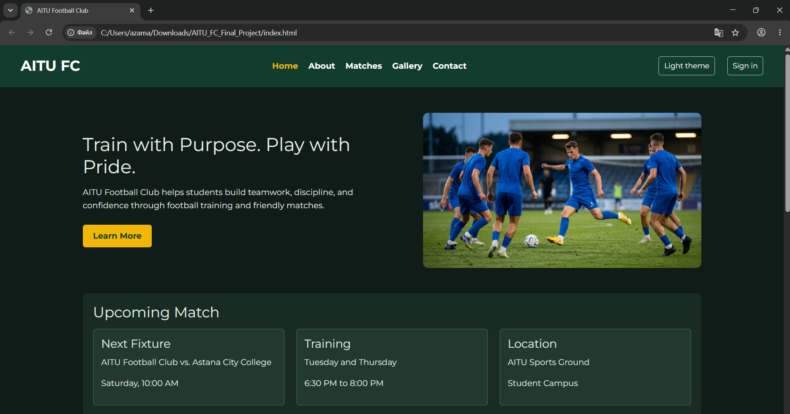
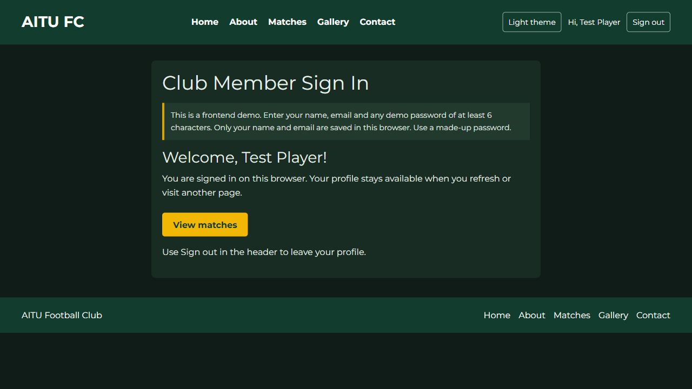
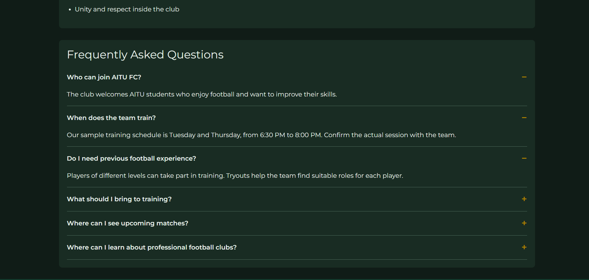
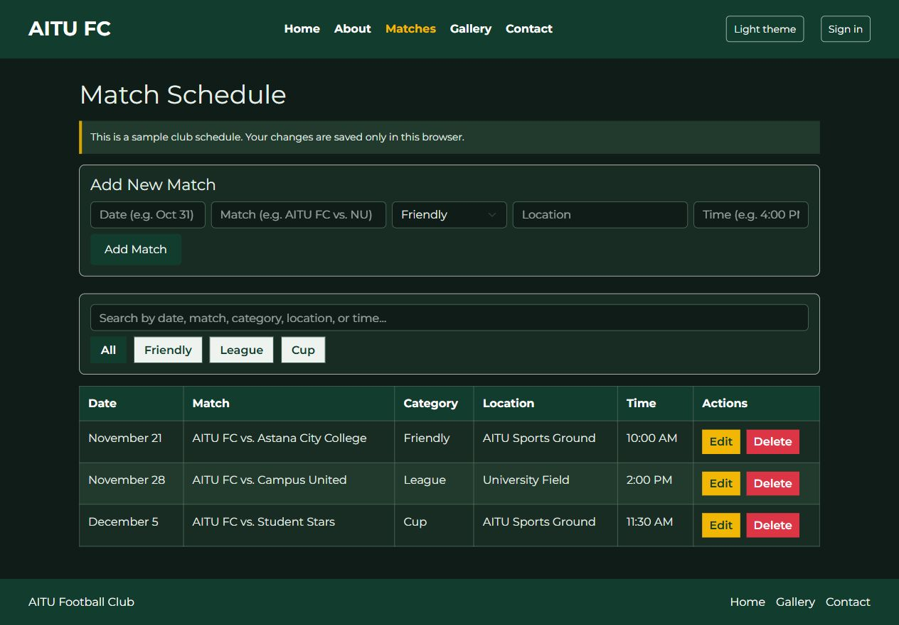
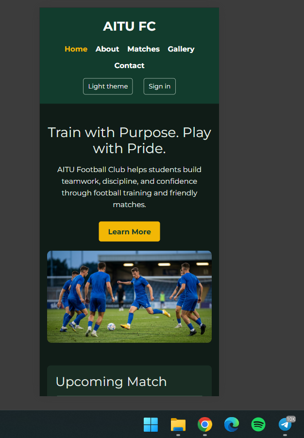

# AITU Football Club — Final Project Report

## 1. Project Overview

AITU Football Club is a website dedicated to the student football club at Astana IT University. It introduces the club, presents training information and sample match schedules, displays a photo gallery, and provides an interactive tryout form.

The final project extends our previous website with a persistent light/dark theme, demo sign-in functionality, an animated FAQ section, and public API integration.

The API feature uses TheSportsDB to display information about professional football clubs.

## 2. Group Members

- Azamat Ray
- Abylaikhan Zhumagul
- Isaali Abdunabi

## 3. Project Objectives

- Develop a responsive website with a consistent design.
- Connect all main pages through accessible navigation.
- Apply HTML, CSS, JavaScript, Bootstrap, and jQuery.
- Save the selected theme and login state using localStorage.
- Retrieve and display football club information from a public API.
- Provide interactive features without reloading the page.

## 4. Website Structure

| Page | Description |
| --- | --- |
| Home — index.html | Club introduction, training information, and Explore Football Clubs API section |
| About — about.html | Club background, mission, values, and six FAQ questions |
| Matches — matches.html | Sample match schedule with search, category filtering, and CRUD operations |
| Gallery — gallery.html | Responsive photo gallery with a lightbox |
| Contact — contact.html | Tryout form with client-side validation |
| Sign In — signin.html | Demo sign-in form and saved user profile |

Every page includes navigation to the five main pages. Theme and account controls are available in the header.

## 5. Technologies Used

- HTML5
- CSS3
- CSS Flexbox and Grid
- Bootstrap 5.3.3
- JavaScript
- jQuery 3.7.1
- localStorage
- Fetch API
- TheSportsDB API

## 6. Implemented Features

### 6.1. Responsive Design

The website uses a consistent green and yellow color scheme, shared typography, and external CSS files.

Flexbox arranges navigation and content blocks. CSS Grid creates the gallery and club detail layouts. Media queries adjust the website for desktop, tablet, and mobile screens.

On smaller screens, content blocks stack vertically. The match table scrolls inside its container to prevent horizontal overflow across the page.

### 6.2. Light and Dark Themes

Users can switch between light and dark themes using the header button.

JavaScript changes the data-theme attribute of the HTML element. CSS variables define the background, text, panel, and border colors.

The selected theme is saved in localStorage under the key aitu-theme. It remains active after refreshing the page and navigating between pages.

### 6.3. Demo Sign-In and Sign-Out

The sign-in form validates a name between 2 and 40 characters, a correctly formatted email address, and a demo password with at least 6 characters after trimming surrounding whitespace.

After successful validation, the user's name and email are saved in localStorage under the key aitu-user.

The header displays a greeting and a Sign out button. The sign-in page displays a welcome panel for signed-in users.

The profile remains available after refreshing the page. Signing out removes the saved profile without deleting the selected theme or match schedule.

This is a frontend demonstration. Passwords are not saved, and credentials are not verified by a server.

### 6.4. Animated FAQ

The About page contains six questions related to the football club.

Clicking a question opens or closes its answer using jQuery slideToggle(). A plus or minus indicator shows whether the answer is collapsed or expanded.

The aria-expanded attribute reflects the current state. The stop() method prevents animations from building up after repeated clicks.

The FAQ also explains where users can explore professional football clubs.

### 6.5. Public API Integration — TheSportsDB

The Home page includes an Explore Football Clubs section connected to TheSportsDB API.

This feature relates directly to the football topic. It allows visitors to learn about professional clubs, their leagues, and their stadiums.

Users can select:

- Arsenal.
- Liverpool.
- Manchester United.

The selected club is retrieved by its unique team ID using the lookupteam.php endpoint. The website uses the documented public free key 123. It does not require a personal API key.

Example request:
https://www.thesportsdb.com/api/v1/json/123/lookupteam.php?id=133604

The website sends the request with fetch(), waits for it using async/await, and converts the JSON response into a JavaScript object with response.json().

The dynamically generated club card displays:

- Club name.
- Country.
- League.
- Stadium.
- Founding year.
- A link to the club's page on TheSportsDB.

The initial club loads automatically. Visitors can choose another club and press Load club. The same button can reload the selected club.

The interface displays a loading message and disables the controls during a request. Old results are cleared before loading new data.

Error handling covers unsuccessful HTTP responses, network failures, invalid response data, and a 12-second timeout. Empty results display a separate message. Missing optional fields display Not available.

The implementation uses team lookup by ID rather than unrestricted name search because the provider limits free name searches. Returned information comes from the external database and may contain missing or inaccurate fields.

API documentation:
https://www.thesportsdb.com/documentation

Relevant implementation:
- index.html — club selection form, status message, and result container.
- js/script.js — loadTeam(), fetch(), response validation, DOM updates, and error handling.
- css/style.css — club controls, detail card, and responsive layout.

### 6.6. Match Schedule and CRUD

The Matches page allows users to create, view, update, and delete matches.

Each match contains a date, teams, category, location, and time.

Deleting a match requires confirmation. Changes are saved in localStorage under the key aitu-matches and remain available after refreshing the page.

The schedule contains sample data. Changes apply only to the current browser.

### 6.7. Search and Category Filtering

The match schedule includes a live search field and category buttons: All, Friendly, League, and Cup.

Search is case-insensitive and works together with the selected category. Matching rows are displayed without reloading the page.

### 6.8. Interactive Gallery

The Gallery page displays football photographs in a responsive grid.

Selecting a photograph opens a lightbox containing an enlarged image, a caption, previous and next buttons, and a close button.

Keyboard controls include Enter or Space to open a photograph, arrow keys to switch photographs, and Escape to close the lightbox.

### 6.9. Tryout Form Validation

The Contact page contains a demonstration tryout form.

Validation checks required fields, email format, minimum password length, password confirmation, and a non-empty message.

A password strength indicator displays weak, medium, or strong feedback. Invalid fields receive visual feedback, and submission is blocked until the errors are corrected.

The form validates information locally and does not send an application to the club.

## 7. Development Process

Development started from our existing Endterm website. We preserved the football club topic, original pages, images, and visual style.

The development process included:

1. Reviewing the final project requirements.
2. Examining the existing pages and interactive features.
3. Adding shared theme and account controls.
4. Creating the sign-in page.
5. Implementing the animated FAQ.
6. Connecting TheSportsDB for football club information.
7. Adding persistent match storage.
8. Improving form behavior and keyboard controls.
9. Adjusting the layout for mobile devices.

All custom JavaScript is implemented in js/script.js. All custom styles are stored in css/style.css. jQuery is included as a separate library file.

## 8. Group Responsibilities

| Member | Responsibilities |
| --- | --- |
| Azamat Ray | Home and About pages, shared layout, theme switching, responsive styling, and TheSportsDB API integration |
| Abylaikhan Zhumagul | Match schedule, CRUD operations, match persistence, gallery, and lightbox controls |
| Isaali Abdunabi | Contact form validation, password strength indicator, demo sign-in and sign-out, FAQ, and documentation |

## 9. Project Screenshots

### 9.1. Home Page and TheSportsDB API

The Home page introduces the club and displays professional club information retrieved from TheSportsDB.

### 9.2. Dark Theme

The dark theme changes the website's colors, including the football club card.

### 9.3. Sign-In Functionality

The signed-in interface displays a welcome message and preserves the user's profile after refreshing.

### 9.4. FAQ Section

The FAQ section uses jQuery slideToggle() to expand and collapse answers.

### 9.5. Match Schedule

The Matches page provides search, category filters, and options to add, edit, and delete matches.

### 9.6. Mobile Layout

The responsive layout adjusts navigation, images, content blocks, and club information for smaller screens.

## 10. Project Links

GitHub repository:
https://github.com/azamatrayyy/front-midterm-football.git

GitHub Pages:
https://azamatrayyy.github.io/front-midterm-football/

## 11. Conclusion

The final project extends the AITU Football Club website with persistent theme preferences, a saved demo profile, animated FAQ answers, and football club information from TheSportsDB.

The website demonstrates responsive design, DOM manipulation, event handling, form validation, localStorage, jQuery effects, and asynchronous JavaScript.

## 12. AI Usage Acknowledgment

During the development of this project, our group used ChatGPT, an AI tool developed by OpenAI, as a supporting tool.

AI assistance included:

- Generating and revising parts of the HTML, CSS, and JavaScript code.
- Helping debug code and suggesting improvements to page structure, responsive styling, form validation, theme switching, and localStorage functionality.
- Supporting the selection and implementation of TheSportsDB API and its error handling.
- Helping consolidate the custom CSS and JavaScript files.
- Drafting and revising project documentation and preparing code explanations for the group.

This acknowledgment covers AI-generated code and text as well as AI-assisted revisions. Group members remain responsible for reviewing the submitted work, verifying its behavior, understanding the implementation, and accurately explaining their own contributions during the defense. AI assistance does not replace individual understanding or responsibility for the project.

The website includes a visible AI assistance credit in the footer of every page.

Tool credited: ChatGPT by OpenAI — https://chatgpt.com/
